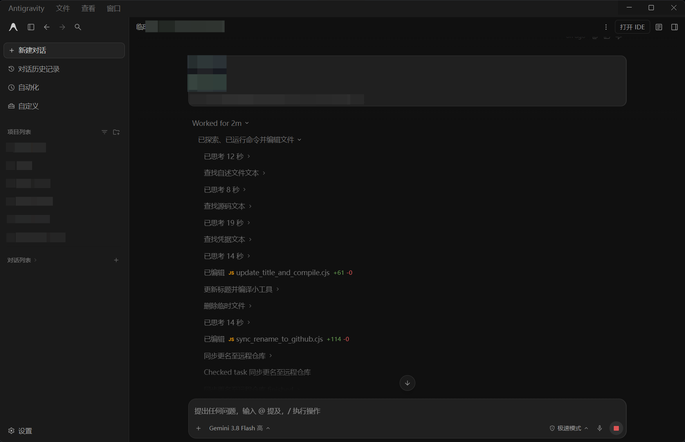
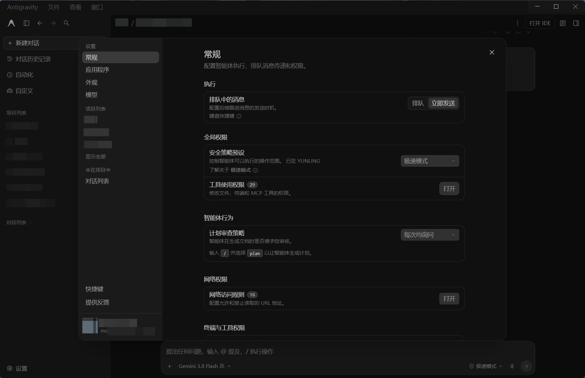
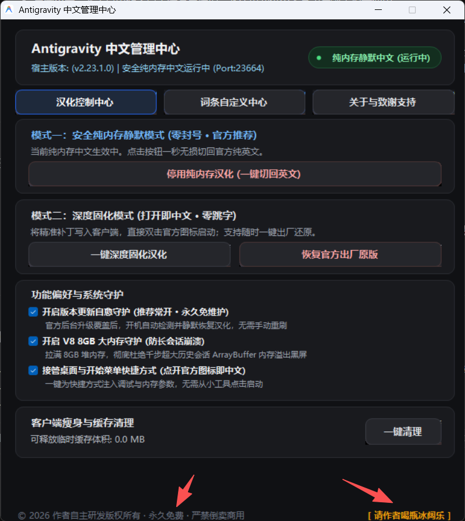
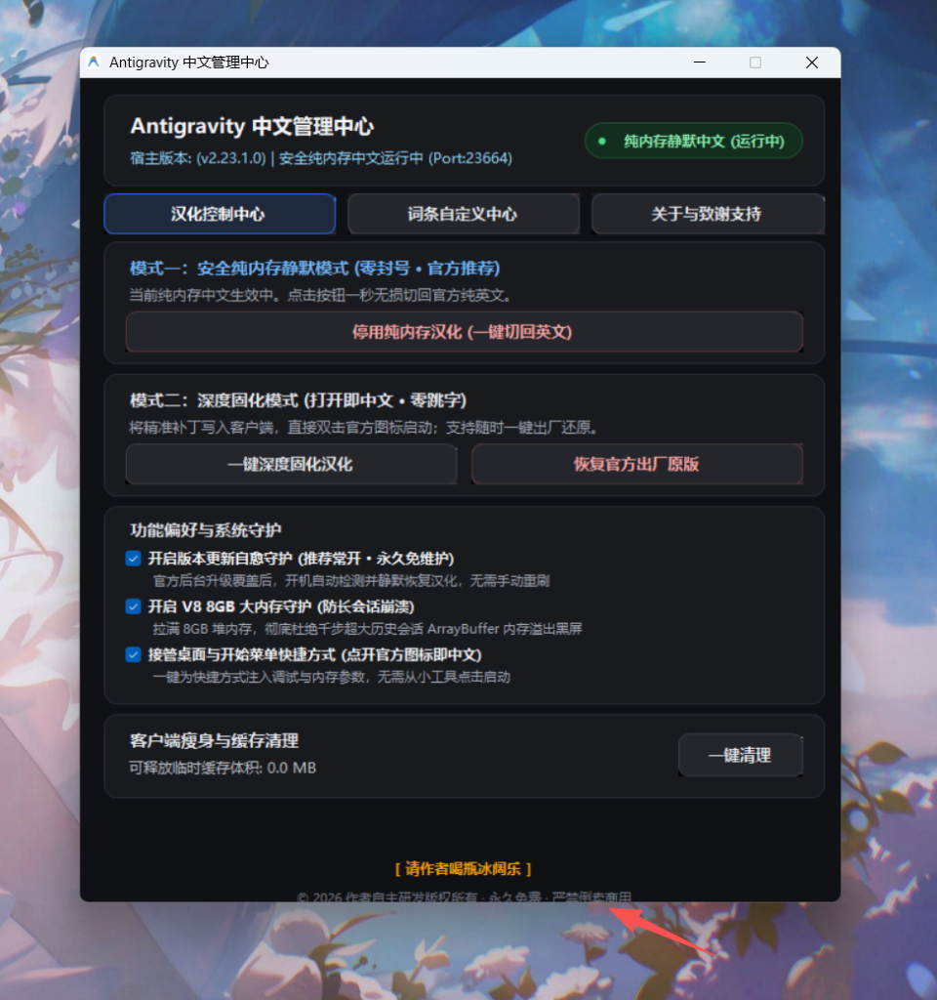
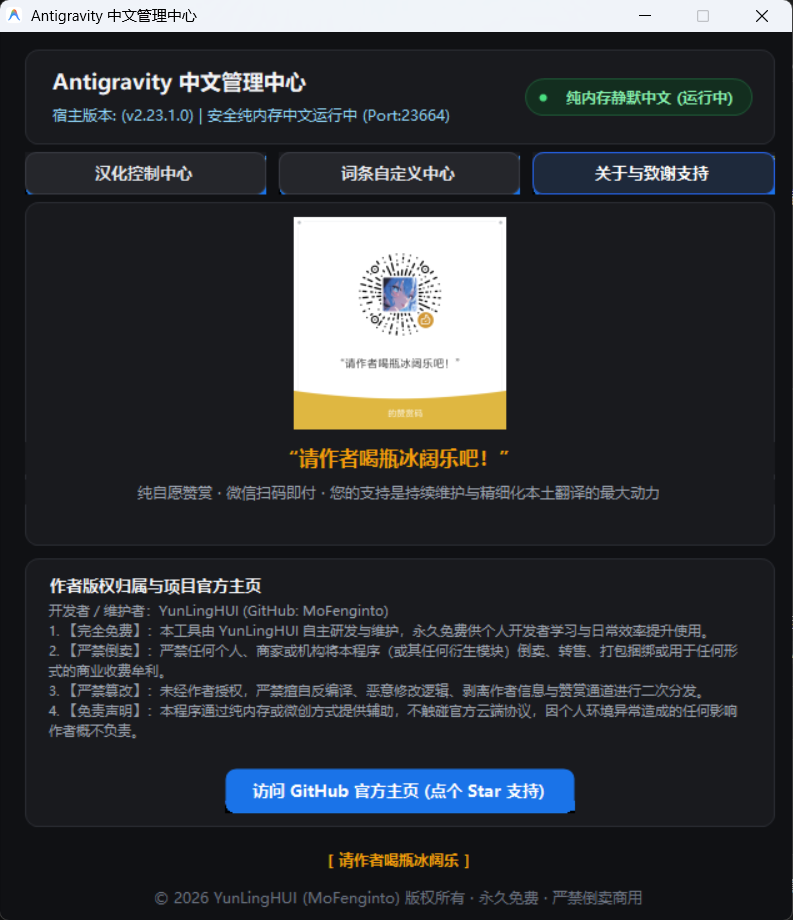
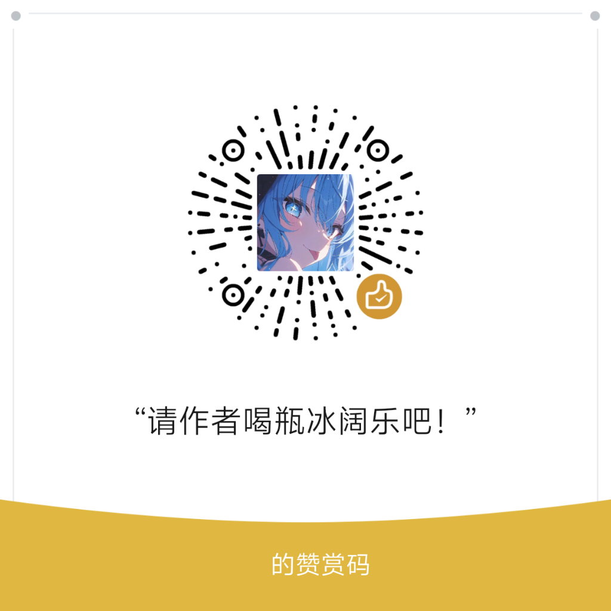

<h1 align="center">Antigravity 汉化工具 (Antigravity-Hans)</h1>

<p align="center">
  <b>Google Antigravity 官方客户端下一代「双模驱动」全功能中文本地化与系统管理解决方案</b><br>
  <b>Next-Generation Dual-Engine Localization Tool for Google Antigravity Client</b><br>
  <i>开发者 / 维护者 (Author & Maintainer)：<b>YunLingHUI</b> (GitHub: @MoFenginto)</i>
</p>

<p align="center">
  <a href="https://github.com/MoFenginto/Antigravity-Hans/stargazers"></a>
  <a href="https://github.com/MoFenginto/Antigravity-Hans/releases"></a>
  
  
  
  
</p>

<p align="center">
  <a href="#一项目背景与痛点终结">简体中文文档</a> &nbsp;|&nbsp; <a href="#english-documentation">English Documentation</a>
</p>

---

## 求 Star 支持 / Star Request

如果您觉得本工具好用、解决了您的英文交互困扰，**请在项目右上角点一个 Star (⭐) 支持作者！**  
您的每一个 Star 和自愿赞赏，都是作者持续跟进 Google 官方最新版本迭代、精细化本地汉化维护的最大动力！

If this project helps you, please consider giving it a **Star** on the top right. Your support is the greatest motivation for continuous maintenance and feature updates!

---

## 目录 (Table of Contents)

- [中文文档](#中文文档)
  - [一、项目背景与痛点终结](#一项目背景与痛点终结)
  - [二、断层优势特性对比](#二断层优势特性对比)
  - [三、双模驱动核心技术架构](#三双模驱动核心技术架构)
    - [模式 I：安全纯内存静默模式 (官方推荐 · 零封号风险)](#模式-i安全纯内存静默模式-官方推荐--零封号风险)
    - [模式 II：深度固化模式 (原生微创打补丁 · 打开即中文)](#模式-ii深度固化模式-原生微创打补丁--打开即中文)
  - [四、独家核心黑科技](#四独家核心黑科技)
  - [五、零封号风险安全合规声明](#五零封号风险安全合规声明)
  - [六、极速使用指南 (开箱即用)](#六极速使用指南-开箱即用)
  - [七、常见问题解答 (FAQ)](#七常见问题解答-faq)
  - [八、请作者喝瓶冰阔乐 (自愿赞赏)](#八请作者喝瓶冰阔乐-自愿赞赏)
  - [九、版权与使用许可声明 (严禁倒卖)](#九版权与使用许可声明-严禁倒卖)
- [English Documentation](#english-documentation)
  - [1. Overview & Architecture](#1-overview--architecture)
  - [2. Dual-Engine Working Modes](#2-dual-engine-working-modes)
  - [3. Key Highlights](#3-key-highlights)
  - [4. Quick Start & Releases](#4-quick-start--releases)
  - [5. Support & Sponsorship](#5-support--sponsorship)
  - [6. License & Anti-Resale Notice](#6-license--anti-resale-notice)

---

# 中文文档

## 界面与汉化效果实录 (Showcase)

<p align="center">
  <b>Antigravity 官方客户端 100% 全量纯中文工作区实录 (隐私已严格打码)</b><br>
  
</p>

<p align="center">
  <b>Antigravity 官方客户端二级设置与高深权限全量汉化实录 (隐私已严格打码)</b><br>
  
</p>

<table align="center" style="margin: 0 auto;">
  <tr>
    <td align="center">
      <b>汉化控制中心 (双模驱动 · 8GB大内存防崩溃)</b><br>
      
    </td>
    <td align="center">
      <b>词条自定义中心 (免重启即时热生效)</b><br>
      
    </td>
  </tr>
  <tr>
    <td colspan="2" align="center">
      <b>关于与致谢支持 (YunLingHUI 版权所有 · 冰阔乐赞赏)</b><br>
      
    </td>
  </tr>
</table>

---
## 一、项目背景与痛点终结

Google Antigravity 是一款顶尖的智能体原生（Agentic）桌面开发客户端。目前官方仅提供纯英文交互界面，由于其前端架构基于极为复杂的 React 虚拟 DOM、流式 Protobuf 消息和 Monaco 核心代码编辑器，传统汉化方案常常面临严重困境：

- **痛点 I（市面 Python 动态注入方案）**：用户必须在本地配置繁琐的 Python 环境与外部依赖包；每次启动都必须在后台常驻一个黑色命令行窗口（CMD/Terminal），极易误触关闭；页面初次加载存在明显的英文闪烁（FOUC）与几百毫秒的“跳字延迟”。
- **痛点 II（粗暴替换 ASAR 方案）**：传统打包往往塞入完整的数兆字节完整 ASAR，不仅文件臃肿（上百兆），而且每次官方静默升级后，旧版补丁极易把官方程序降级回旧版本，引发协议与通信错乱；孤立短词强行替换，导致“类型 / and select plan...”等生硬中英夹生饭。

为了从根本上终结这些工程痛点，**Antigravity-Hans** 由 **YunLingHUI** 自主研发推出。本项目采用独创的「双模驱动架构」，将原生 C# 单文件汉化工具、零依赖 CDP 纯内存注入管道、微创 ASAR 动态打补丁引擎、可视化词条自定义工作台与 2,313+ 条高精词典高度集成，单文件仅 600KB，零外部依赖，开箱即用！

---

## 二、断层优势特性对比

| 衡量维度 | 市面 Python + WebSocket 方案 | 传统粗暴 ASAR 替换补丁 | Antigravity 汉化工具 (本项目) |
| :--- | :--- | :--- | :--- |
| **可执行程序体积** | 需安装数百兆 Python 运行库 | 依赖外部完整 ASAR (9MB+) | **单文件仅 600KB 极致轻量** |
| **运行环境依赖** | 强依赖本地 Python 运行时与 pip 包 | 需手动解包/安装第三方工具 | **100% 零第三方依赖**，Windows 自带 .NET 即开即用 |
| **后台运行形态** | 必须常驻黑色控制台终端窗口 | 无 | **纯静默运行**，原生 WinExe 无任何黑框打扰 |
| **本地文件改动** | 仅运行时注入，不改动磁盘文件 | 强制全量覆盖官方 ASAR 文件 | **双模自由切换**：支持 100% 磁盘零改动与微创固化 |
| **官方数字签名** | 保持官方签名（依赖外部注入） | 破坏官方 ASAR 完整性与签名 | **纯内存模式 100% 保留官方原生签名与完整字节** |
| **跨版本兼容性** | 官方更新后可能选择器失效 | 极易导致客户端被强制降级崩溃 | **就地微创动态打补丁，终生自适应官方新版本** |
| **词条个性化** | 无法自定义或需手动改脚本 | 词库写死在包内，无法修改 | **内置可视化词条编辑器，支持免重启热生效与导入导出** |
| **界面首屏延迟** | 存在 300~800ms 英文闪烁与跳字 | 首屏即中文，无跳字 | 深度固化模式**零毫秒跳字**；纯内存模式**平滑无感注入** |
| **长句精准度** | 孤立短词匹配，易出现中英混杂 | 词库易冲突，破坏代码结构 | **2,313+ 条精准全词全句匹配** + 正则动态捕获 |
| **长会话稳定性** | 易触发官方前端 V8 内存溢出黑屏 | 无法防御超大会话崩溃 | **独家 V8 8GB 大内存守护**，彻底杜绝千步会话闪退 |
| **快捷方式接管** | 每次需从小工具或批处理启动 | 必须双击修改后的程序 | **全自动无痕挂钩**，直接双击桌面官方图标即中文 |
| **宿主进程安全** | 启动脚本易冲突 | 部分工具采用 Taskkill 强杀进程 | **绝对零强杀铁律**，会话通信零中断、账号凭据零丢失 |
| **一键出厂还原** | 退出脚本即可 | 多数无备份，更新后失效 | **自动就地出厂备份**，随时一秒无损回退官方原版 |

---

## 三、双模驱动核心技术架构

### 模式 I：安全纯内存静默模式 (官方推荐 · 零封号风险)
* **核心定位**：专为对账号安全、官方原版纯净度有极致要求的专业开发者设计。
* **底层机制 I（出厂签名零改动）**：本地磁盘上的 `resources/app.asar` 100% 永久保持官方出厂原版（严格保留官方原版字节），SHA256 哈希与 Google 官方数字签名毫发无损。
* **底层机制 II（纯静默调试管道）**：管理工具通过 Chrome DevTools Protocol (CDP) 调试管道拉起官方程序，利用 .NET 原生 `ClientWebSocket` 管道纯静默建立通信。
* **底层机制 III（直接内存映射）**：通过 `Page.addScriptToEvaluateOnNewDocument` 与 `Runtime.evaluate` 指令，将纯净汉化引擎直接映射写入渲染进程内存。
* **底层机制 IV（无痕即用即释放）**：进程在内存中即时完成 DOM 转译，客户端关闭后内存瞬间释放，磁盘零任何残留修改。
* **底层机制 V（智能动态双向热开关）**：管理工具内置动态状态识别，支持在软件运行中随时一键“开启纯内存中文”与“停用切回官方英文”，无需重启客户端，随点随切。

### 模式 II：深度固化模式 (原生微创打补丁 · 打开即中文)
* **核心定位**：追求极致加载速度、零毫秒跳字、希望日常直接双击官方桌面快捷方式即可获得全中文体验的用户。
* **底层机制 I（尾部微创追加算法）**：彻底颠覆传统“覆盖整个 ASAR”的笨拙做法，采用独家 MiniAsarPatcher 尾部追加算法，耗时仅 0.05 秒就地修补本地 `resources/app.asar` 中的 `dist/preload.js`。
* **底层机制 II（整树剪枝精准哈希）**：补丁内置常数级精准词典哈希映射（Exact Map），并在 TreeWalker 遍历中挂载 `NodeFilter.FILTER_REJECT` 进行整树剪枝，严格避开用户聊天消息流与代码块。
* **底层机制 III（一秒出厂级无损还原）**：首次安装自动就地生成 `app.asar.official_backup`，支持随时点击“恢复官方出厂原版”，一秒无损还原。

---

## 四、独家核心黑科技

* **特性 I. 原生微创尾部追加打补丁算法 (MiniAsarPatcher)**：精准解析 Chromium Pickle ASAR 二进制协议。原版全部 1,084 个文件的数据在数据区中的物理位置完全不动，仅将汉化脚本追加在原数据区末尾，重构头部索引树并刷新 SHA256 校验。未来官方客户端静默更新后，小工具直接就地读取最新版的 asar 并微创修补，终生自适应！
* **特性 II. 可视化词库编辑器与免重启即时热生效**：管理小工具内置专属【词条自定义中心】，自动解析 2,313 条原生高精词条，支持实时模糊搜索、免重启即时热生效、以及词库的导入导出。
* **特性 III. 快捷方式全链路智能无痕接管**：自动扫描用户桌面快捷方式以及开始菜单，智能注入参数。日常使用直接双击桌面上的 Antigravity 官方图标，即可全自动以纯内存中文模式启动！
* **特性 IV. 独家 V8 8GB 大内存防崩溃守护**：自动向启动链路注入官方标准参数 `--js-flags="--max-old-space-size=8192"`，将堆内存上限扩展至 8GB，彻底消除千步超长排查会话的崩溃隐患。
* **特性 V. 宿主进程零强杀安全保障**：坚决杜绝任何后台静默 `taskkill`，保障当前所有活跃会话通信零中断、账号凭据零损坏。
* **特性 VI. 客户端瘦身与缓存一键清理**：智能扫描缓存目录，一键释放冗余垃圾。

---

## 五、零封号风险安全合规声明

* **准则 I. 官方标准通道对接**：安全纯内存静默模式所调用的 `--remote-debugging-port` 为 Chromium 与 Electron 官方公开、正规支持的标准开发者通信接口，完全属于官方框架允许的功能范畴。
* **准则 II. 零核心文件篡改**：纯内存模式下，磁盘上的所有可执行文件、核心动态库及 ASAR 归档均未发生任何单字节更改，完全通过 Google 官方更新程序与数字安全校验。
* **准则 III. 零隐私数据嗅探**：汉化引擎仅在本地浏览器渲染进程上下文中执行文本节点转译，绝不监听、收集、上传任何用户的输入内容、代码片段或模型交互上下文。

---

## 六、极速使用指南 (开箱即用)

### 方式 0：独家神仙操作 · 对 Antigravity 内置 AI 发一句话搞定 (全平台通用)

无论您正在使用 **Windows**、**macOS** 还是 **Ubuntu / Linux**，甚至连终端都不需要打开！  
直接在 Antigravity 客户端的**任意聊天输入框**中，复制并发送以下指令：

```text
帮我从 https://github.com/MoFenginto/Antigravity-Hans 下载并安装汉化
```

> **原理说明**：Antigravity 内置的 AI 助手接收到指令后，将自动调用系统原生工具链执行安全寻址、下载最新汉化核心并完成冷替换，真正做到“动动嘴皮子，客户端秒变 100% 纯中文”！

---

### 方式 1：Linux (Ubuntu / Debian / Arch / Fedora) & macOS 终端一键安装

在系统的终端中，直接复制并粘贴执行以下一行命令即可全自动完成配置：

```bash
curl -fsSL https://raw.githubusercontent.com/MoFenginto/Antigravity-Hans/main/install.sh | bash
```

* 如需恢复出厂官方英文原版，随时运行：`bash install.sh --restore`。

---

### 方式 2：Windows PowerShell 终端一键静默安装

在 Windows 终端（PowerShell）中执行以下一行命令：

```powershell
irm https://raw.githubusercontent.com/MoFenginto/Antigravity-Hans/main/install.ps1 | iex
```

* 如需恢复出厂官方英文原版，随时运行：`irm ... | iex -Restore`。

---

### 方式 3：Windows 绿色单文件 GUI 管理中心 (可视化控制)

如果您喜欢可视化窗口操作，前往本仓库的 [Releases 页面](https://github.com/MoFenginto/Antigravity-Hans/releases) 下载独立绿色单文件：
- **`Antigravity汉化管理小工具.exe`**（约 600KB，零环境依赖，无黑框）

1. **运行小工具**：双击运行 `Antigravity汉化管理小工具.exe`；
2. **选择汉化模式**：
   - **安全纯内存模式 (推荐)**：点击【安全启动官方原版 (纯内存中文)】即可；
   - **深度固化模式**：点击【一键深度固化汉化】，0.05 秒完成就地微创补丁；
3. **日常启动**：直接双击桌面的 Antigravity 官方图标即可享受中文！
4. **一键还原**：随时在工具中点击【恢复官方出厂原版】，一秒无损回退官方英文。

---

## 七、常见问题解答 (FAQ)

#### Q1: 运行纯内存模式会影响账号安全或封号吗？
**绝对不会。** 纯内存模式 100% 不修改本地磁盘上的任何官方文件，不篡改程序数字签名。通信只在本地回环接口（127.0.0.1）进行，Google 云端服务器无法亦无权感知任何客户端本地 DOM 文本的呈现变动。

#### Q2: 官方发布新版本更新后，汉化会失效吗？
- **纯内存模式**：官方静默升级后，直接启动即可继续享受中文，完全不与官方升级产生任何文件冲突；
- **固化模式**：小工具内置跨版本自适应的 MiniAsarPatcher，官方更新覆盖后直接点击固化，0.05 秒就地为官方最新版本完成微创打补丁，永不降级冲突。

#### Q3: 自定义词典保存在哪里？
保存在您的用户数据目录 `%APPDATA%\Antigravity\user_custom_dict.json` 中，您可以通过小工具界面随时一键导出为独立 JSON 文件备份。

---

## 八、请作者喝瓶冰阔乐 (自愿赞赏)

本工具为作者 **YunLingHUI** 利用业余时间倾力自主研发并永久免费提供。  
如果您觉得这个小工具为您带来了便利、提升了开发效率，欢迎微信扫码请作者喝瓶冰阔乐！您的每一份自愿支持，都是作者持续跟进官方更新、精细化本地汉化维护的最大动力！

<p align="center">
  <br>
  <b>“请作者喝瓶冰阔乐吧！”</b><br>
  <i>纯自愿赞赏 · 微信扫码即付 · 您的支持是持续维护与精细化本土翻译的最大动力</i>
</p>

---

## 九、版权与使用许可声明 (严禁倒卖)

```
版权所有 (C) 2026 YunLingHUI (GitHub: @MoFenginto) 保留所有权利。

1. 【完全免费】：本软件由 YunLingHUI 自主研发与精细化维护，永久免费供个人开发者学习与日常效率提升使用。
2. 【严禁倒卖与商用】：严禁任何个人、商家、平台或机构将本程序（或其任何衍生模块、二进制文件）倒卖、转售、打包捆绑进付费教程、或用于任何形式的商业收费牟利！违者必究其法律责任！
3. 【严禁恶意篡改】：未经作者书面授权，严禁擅自反编译、恶意修改逻辑、剥离作者署名与赞赏信息进行二次分发。
4. 【防伪唯一发布源】：本项目的唯一正统发布渠道为 GitHub 官方仓库：https://github.com/MoFenginto/Antigravity-Hans
   任何从淘宝、闲鱼、微信群或其他第三方付费渠道获取的本程序均为非法盗版，请立即举报！
5. 【免责声明】：本程序通过纯内存或微创方式提供辅助，不触碰官方云端协议，因个人环境异常造成的任何影响作者概不负责。
```

---

# English Documentation

## 1. Overview & Architecture

**Antigravity-Hans** is a next-generation, dual-engine localization and management solution designed specifically for the official Google Antigravity desktop client.

Developed autonomously by **YunLingHUI**, it eliminates all conventional localization pain points:
- **Ultra-lightweight**: Single portable executable of only ~600KB.
- **Zero Third-Party Dependencies**: Native C# implementation built on the native Windows .NET Framework.
- **Dual-Engine Flexibility**: Seamlessly toggle between **Pure In-Memory Silent Mode** (Zero disk modifications, zero ban risk) and **Deep Permanent Solidification Mode** (Zero millisecond jump-cut).
- **V8 8GB Memory Guard**: Automatically expands the Electron heap memory limit to 8GB, preventing array buffer allocation crashes in long-running agentic conversations.

---

## 2. Dual-Engine Working Modes

### Mode I: Pure In-Memory Silent Mode (Recommended · Zero Ban Risk)
- Keeps the official `resources/app.asar` completely untouched on disk with Google's official digital signature intact.
- Injects the localization engine directly into the Electron rendering process memory via the standard Chrome DevTools Protocol (CDP) WebSocket pipeline.
- Completely silent without any terminal windows. Changes are released immediately upon application exit.

### Mode II: Deep Permanent Solidification Mode (Micro-Invasive Patching)
- Employs an exclusive **MiniAsarPatcher tail-append algorithm** to modify `dist/preload.js` in ~0.05 seconds without rewriting existing file payloads.
- Delivers instantaneous Chinese rendering from the very first frame with zero millisecond latency.
- Features an automated one-click official restore mechanism at any time.

---

## 3. Key Highlights

- **Visual Vocabulary Customization Center**: Built-in 2,313+ translation dictionary with instant hot-reload (no client restart required).
- **Shortcut Auto-Takeover**: Directly launch the official desktop shortcut to enjoy Chinese localization automatically.
- **Process Protection**: Strictly avoids aggressive process termination (`taskkill`) to safeguard user sessions.
- **Cache Cleaner**: Quickly frees up hundreds of megabytes of cached assets.

---

## 4. Quick Start & Releases

Download the standalone portable program directly from the [Releases](https://github.com/MoFenginto/Antigravity-Hans/releases) page:
- **`Antigravity-Hans-Manager.exe`** (~600KB, portable, no installation required).

1. Run `Antigravity-Hans-Manager.exe`.
2. Choose your preferred mode:
   - Click **[安全启动官方原版 (纯内存中文)]** for Pure Memory Mode.
   - Click **[一键深度固化汉化]** for Instant Solidification Mode.
3. Enjoy your native Chinese experience in Google Antigravity!

---

## 5. Support & Sponsorship

If you find this tool helpful in your daily workflows, feel free to sponsor the author with a cold bottle of Coke via WeChat Pay! Your generosity keeps this project actively maintained alongside official Google updates.

*(Please refer to the WeChat QR code in the Chinese section above or directly within the application's About panel.)*

---

## 6. License & Anti-Resale Notice

```
Copyright (C) 2026 YunLingHUI (GitHub: @MoFenginto). All Rights Reserved.

1. [Free for Personal Use]: Free for individual developers for educational and efficiency purposes.
2. [Strictly Prohibited: Resale & Commercial Use]: Reselling, repackaging, or incorporating this software into paid bundles/courses is strictly forbidden.
3. [Strictly Prohibited: Reverse Engineering]: Decompiling, reverse-engineering, modifying logic, or stripping author credits/sponsorship channels without authorization is strictly prohibited.
4. [Official Distribution Channel]: https://github.com/MoFenginto/Antigravity-Hans
5. [Disclaimer]: Provided "as is" without warranty of any kind.
```

---

<p align="center">
  <b>⭐ If you like this project, please star this repository on GitHub! ⭐</b>
</p>
