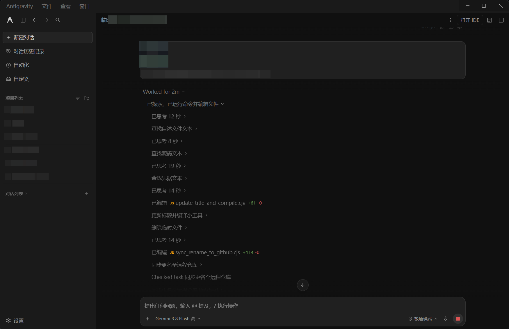
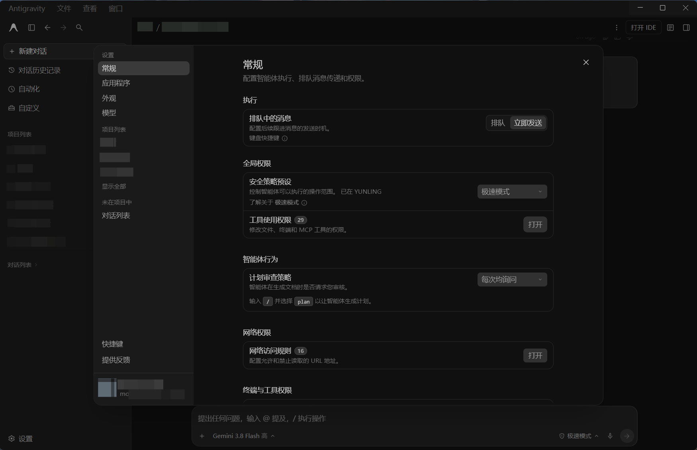
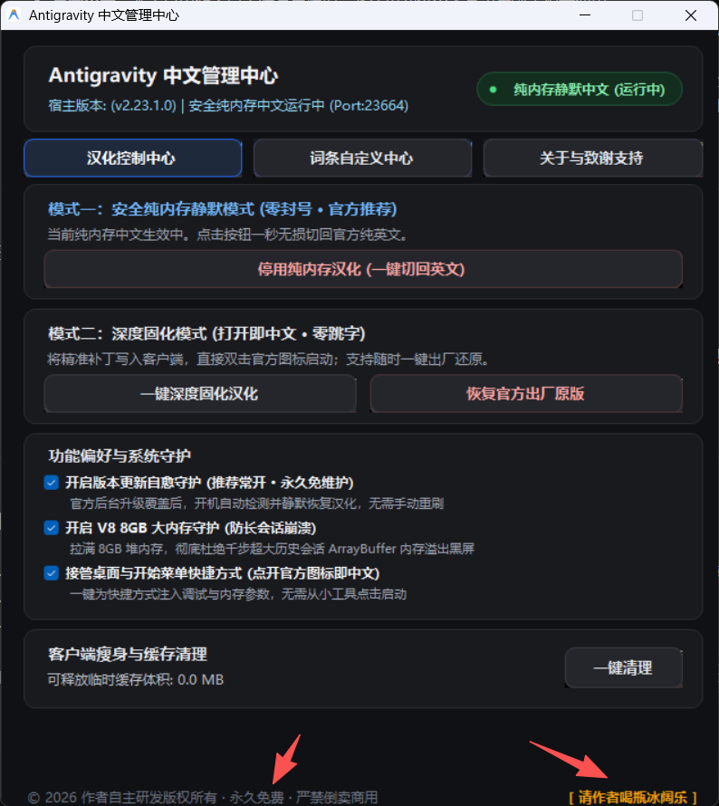
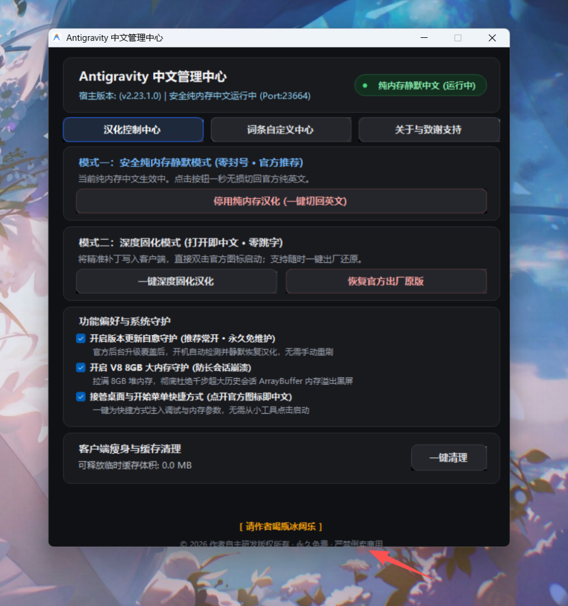

<h1 align="center">Antigravity 汉化工具</h1>

<p align="center">
  <b>Google Antigravity 官方桌面客户端一键中文汉化管理工具</b><br>
  <i>作者 / 维护者：YunLingHUI (GitHub: @MoFenginto)</i>
</p>

<p align="center">
  <a href="https://github.com/MoFenginto/Antigravity-Hans/releases"></a>
  
  
  
</p>

---

## 工具简介

本工具专为 Google Antigravity 桌面客户端打造，用于解决官方客户端无中文界面的交互痛点。

只需点击一次，即可将客户端内的主界面、侧边栏、对话列表、设置面板、右键操作菜单及插件市场等全部转换为规范、自然的简体中文，并支持随时一秒无损还原官方原版英文。

---

## 汉化效果展示

<p align="center">
  <b>主界面与对话工作区汉化效果</b><br>
  
</p>

<p align="center">
  <b>常规设置与权限面板汉化效果</b><br>
  
</p>

<p align="center">
  <b>汉化管理小工具主界面与自定义词库</b><br>
  
  &nbsp;&nbsp;
  
</p>

---

## 核心功能

1. **全界面深度汉化**：涵盖侧边栏、对话区、设置偏好、右键菜单（重命名、置顶、拆分等）以及插件市场详情；
2. **双模式随心选择**：
   - **模式一：纯内存汉化（推荐）**：不改动本地客户端任何物理文件，随关随退，100% 保持官方出厂数字签名；
   - **模式二：一键深度固化**：修改一次客户端核心，以后直接点击官方快捷方式启动即是中文；
3. **随时一键还原官方**：小工具内提供“恢复官方出厂原版”按钮，点击即可瞬间恢复官方纯英文状态；
4. **单文件绿色便携**：Windows 版无需安装任何运行环境，双击即可直接运行；
5. **词条自定义**：内置词条自定义中心，支持自行修改或增加中文翻译。

---

## 下载与使用方法

### Windows 用户（推荐）

1. 前往 [Releases 发布页面](https://github.com/MoFenginto/Antigravity-Hans/releases) 下载最新的 **`Antigravity汉化管理小工具.exe`**；
2. 双击打开小工具：
   - 若想不改动本地文件：保持 Antigravity 运行，点击 **【开启纯内存汉化】** 即可；
   - 若想直接点击官方图标即是中文：退出 Antigravity，点击 **【一键深度固化汉化】** 即可。

### Linux / macOS 用户

打开系统终端，复制并执行以下一键安装命令：

```bash
curl -fsSL https://raw.githubusercontent.com/MoFenginto/Antigravity-Hans/main/install.sh | bash
```

如需卸载或还原英文，终端执行：

```bash
curl -fsSL https://raw.githubusercontent.com/MoFenginto/Antigravity-Hans/main/install.sh | bash -s -- --uninstall
```

---

---

## 仓库文件说明

| 文件 / 目录 | 用途说明 |
| :--- | :--- |
| `src/` | 汉化管理小工具（C# WinForms）与汉化引擎源码 |
| `resources/` | 小工具运行图标、内置汉化引擎及官方还原备份 |
| `assets/` | 软件运行界面与汉化效果展示截图 |
| `build.bat` | Windows 原生编译器一键构建脚本 |
| `install.ps1` | Windows PowerShell 一键安装与还原脚本 |
| `install.sh` | Linux / macOS 终端一键安装与还原脚本 |
| `README.md` | 中文使用指南与功能简介 |
| `LICENSE` | 开源专有许可证（永久免费，严禁倒卖商用） |
| `.gitignore` | Git 版本忽略清单（严防私密与无关文件上传） |
| `.gitattributes` | 跨平台换行格式规范 |

---

## 常见问题

- **Q: 汉化后能恢复回英文吗？**  
  A: 完全可以。在小工具中随时点击【恢复官方出厂原版】或【停用纯内存汉化】，即可一键恢复纯英文。
- **Q: Antigravity 官方更新后汉化失效了怎么办？**  
  A: 打开小工具重新点击一次汉化即可；若官方有大版本改动，小工具会自动提示更新，届时获取最新版本即可适配。

---

## 使用许可与版权声明

- 本工具完全免费开源，仅供个人学习、研究与交流使用；
- 严禁任何人将本工具、汉化包或修改版用于任何商业营利行为、付费打包出售或二手倒卖。
